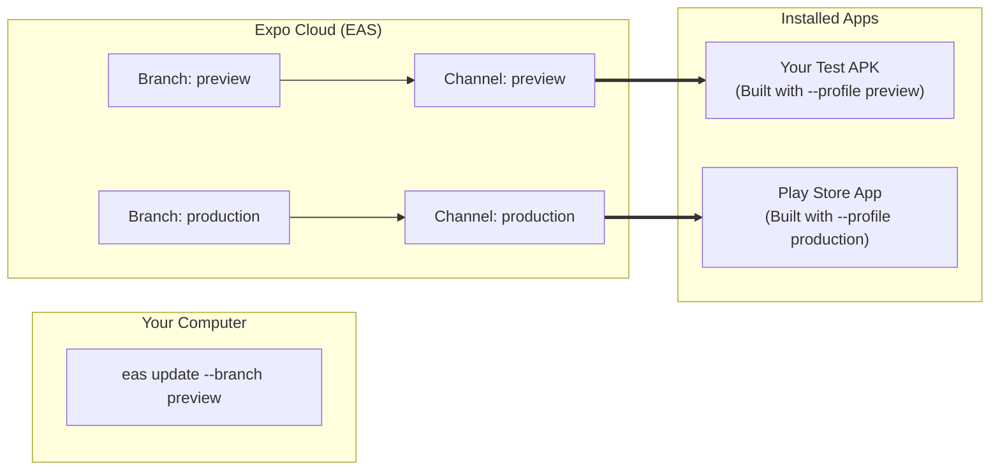

# Understanding Expo (EAS): Build Profiles, Channels, Branches & Environments

Here is a clear breakdown of how **Build Profiles**, **Channels**, **Branches**, and **Environments** work in Expo (EAS), plus a critical configuration quirk in `app.json` to keep in mind before going live on the Google Play Store.

---

## 1. The 4 Concepts in Plain English

Think of EAS like a TV broadcast system:



### A. Build Profile (in `eas.json`)
A **Build Profile** is the recipe used when you run `eas build --profile <name>` to create a binary (`.apk` or `.aab`):
- **`preview` profile** (in `eas.json`): Builds an `.apk` file you can install directly on your phone to test.
- **`production` profile** (in `eas.json`): Builds an `.aab` (Android App Bundle) file that you upload to the Google Play Store.

### B. Channel (baked into the binary at build time)
Every binary built by EAS has a **Channel name** permanently baked into its native code (`"channel": "preview"` or `"channel": "production"` in `eas.json`).
- A phone running a `preview` build will **only** ever ask Expo's servers: *"Do you have any updates on the `preview` channel?"*
- A phone running the Play Store (`production`) build will **only** ever ask: *"Do you have any updates on the `production` channel?"*
- Because the channel is baked into the native binary, an installed app never changes which channel it listens to.

### C. Branch (where you send your OTA updates)
A **Branch** is a stream of JS/OTA updates on Expo's servers.
- By default, EAS links the **`preview` branch** to the **`preview` channel**, and the **`production` branch** to the **`production` channel**.
- When you run:
  ```bash
  eas update --branch preview --message "test new feature"
  ```
  ONLY phones running the **`preview` APK** receive that OTA update. Your Play Store users on **`production`** won't see it at all!
- Once you test it on your `preview` APK and everything works, you push to Play Store users by running:
  ```bash
  eas update --branch production --message "release new feature"
  ```

### D. Environments (Environment Variables on Expo Dashboard)
In your Expo Dashboard (**Project → Environment variables**), Expo gives you three environments: **Development**, **Preview**, and **Production**.
- When `eas build` runs in the cloud, it automatically pulls the variables for that profile's environment.
- **Important trap:** When you run `eas update` **on your own laptop**, EAS bundles the JS locally on your computer first. That means it reads your local `.env` file (unless you pass `--environment preview` or `--environment production` in newer EAS CLI versions). Keep your local `.env` complete so local `eas update` always has every `EXPO_PUBLIC_*` variable!

---

## 2. CRITICAL Catch in `app.json` Before Play Store Launch

Look at the `updates` section of `app.json`:

```json
    "updates": {
      "url": "https://u.expo.dev/0da6be6a-07fb-4ecc-bb6a-80d0cb83ed21",
      "requestHeaders": {
        "expo-channel-name": "production"
      }
    },
```

**What this does:**
Putting `"expo-channel-name": "production"` hardcoded inside `app.json` forces **every build** to hardcode the `"production"` channel header, unless `eas build` overwrites it during cloud build!
- Even worse: if on the Expo Dashboard your **`preview` channel** is pointing to the `preview` branch, or your **`production` channel** was temporarily pointed to the `preview` branch on the Expo website, both builds could end up receiving the same OTA!
- You do **not** need `"requestHeaders": { "expo-channel-name": "production" }` in `app.json`, because `eas.json` already sets `"channel": "preview"` on the `preview` profile and `"channel": "production"` on the `production` profile automatically.

---

## 3. How to Test Safely Once You Are on the Play Store

Here is the exact workflow used by production Expo apps so you never break your Play Store users:

### Setup (Keep 2 apps or know which build is on your phone)
1. **Play Store build (`production` profile):**
   - Built with `eas build --platform android --profile production`
   - Uploaded to Google Play Store.
   - Listens to `--branch production`.
2. **Test APK (`preview` profile):**
   - Built with `eas build --platform android --profile preview`
   - Installed directly on your test device (or via an internal test link).
   - Listens to `--branch preview`.

### Your Day-to-Day Workflow
1. **When you finish coding a JS/UI change:**
   Push the OTA to `preview` first:
   ```bash
   eas update --branch preview --message "Test lyrics upload"
   ```
2. **Open your `preview` APK** (close and reopen it twice so it downloads and applies the OTA). Test everything thoroughly.
3. **Once you are 100% happy with it on `preview`:**
   Send the exact same code to your Play Store users:
   ```bash
   eas update --branch production --message "Release lyrics upload"
   ```

---

## 4. The Golden Rule of OTA (`runtimeVersion: fingerprint`)

In `app.json`, you have:
```json
"runtimeVersion": {
  "policy": "fingerprint"
}
```
This means Expo computes a hash ("fingerprint") of your **native code** (installed npm packages with native Android code, `app.json` plugins, icons, Kotlin code in `modules/`).
- **If you only change TypeScript/JS files (`app/`, `components/`, `hooks/`, `services/`):** The fingerprint stays the same, so `eas update` works via OTA without a new Play Store build.
- **If you add a new native package or edit Kotlin code:** The fingerprint changes. An old APK/Play Store app will **ignore** OTA updates with a different fingerprint (so it won't crash!), and you must run `eas build` to make a new binary.

2. Gem api 4 prod and testing (pro/paid and free)