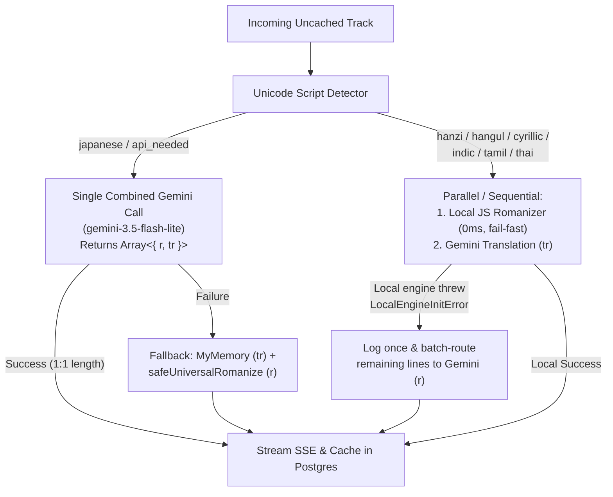

# Fix Romanization Engines & Upgrade to Hybrid AI Pipeline in Supabase Edge Functions

## Goal Description

Stabilize and scale all romanization and translation pipelines in Supabase Edge Functions by adopting a **Hybrid Architecture**:

1. **Remove `@sglkc/kuroshiro` and `@sglkc/kuroshiro-analyzer-kuromoji**` completely from the Edge Runtime to eliminate 256 MB RAM OOM risks, 2 s CPU cold-start spikes, and Storage egress costs.
2. **Merge translation (`tr`) and romanization (`r`) into a single structured Gemini call (`gemini-3.5-flash-lite`)** for `japanese` and `api_needed` (Arabic/Hebrew) tracks—eliminating extra network latency while delivering higher-accuracy J-Pop/anime Romaji.
3. **Fix all latent bugs in the lightweight, 0 ms local JS engines** (Cyrillic, Korean, Chinese, Indic) and `resolveExport()`, plus add fail-fast error handling to prevent per-line retry storms.

Because `fetch-lyrics/index.ts` must remain completely standalone (no imports from `_shared/`) while `upload-lyrics/index.ts` imports from `_shared/lyricsPipeline.ts`, identical changes will be applied to both files.

---

## Architecture Overview



---

## Key Architectural Decisions

> [!IMPORTANT]
> **Why Kuromoji Was Removed:**
> Supabase Edge Functions share a **256 MB memory limit** and **2 s CPU limit** across concurrent requests on an isolate. Loading Kuromoji's decompressed dictionary (~50–80 MB RAM) and downloading/gunzipping 17.8 MB of `.dat.gz` files on cold starts risks `546` OOM crashes under concurrency and burns through Supabase Storage egress. Because every cache miss already makes a Gemini API call for English translation, merging Japanese Romaji into that exact same `gemini-3.5-flash-lite` JSON call adds **0 ms of extra network round-trips**, costs ~$0.00125 per uncached song, keeps isolates at ~25–30 MB RAM, and caches permanently in Postgres for $0.00 repeat reads.
> 
> 

> [!NOTE]
> **Zero External Dict Infrastructure Required:**
> Removing Kuromoji eliminates the need for `KUROMOJI_DICT_PATH`, `KUROMOJI_DICT_URL`, S3FS mounts, and the public `kuromoji-dict` Storage bucket.
> 
> 

---

## Pitfalls & Bugs Resolved

| # | Bug / Pitfall | Root Cause | Fix in This Plan |
| --- | --- | --- | --- |
| 1 | **Kuromoji OOM, CPU & Egress Risk** | Loading a 50–80 MB dictionary and streaming 17.8 MB `.dat.gz` files inside a 256 MB isolate causes `546` crashes under load. | Remove Kuroshiro/Kuromoji completely; route `japanese` to the combined `gemini-3.5-flash-lite` `{ r, tr }` call. |
| 2 | **Retired Gemini Model (`gemini-2.5-flash`)** | `gemini-2.5-flash` is retired and auto-rerouted.

 | Upgrade all Gemini calls to `gemini-3.5-flash-lite`. |
| 3 | **Double AI Latency on `api_needed` / Fallback Tracks** | Translation (`tr`) and romanization (`r`) were executed as two separate sequential Gemini calls.

 | Merge `r` and `tr` into a single JSON Schema call (`Array<{ r, tr }>`) for `japanese` and `api_needed` scripts. |
| 4 | **`resolveExport()` Candidate Priority Bug** | `ns?.default` was checked *before* explicitly requested `names`, ignoring named exports if a default function existed.

 | Check explicit `names` (`ns?.[n]`, `ns?.default?.[n]`) first, falling back to `ns?.default` last. |
| 5 | **64× Retry Storm on Engine Failure** | A broken local engine threw on every iteration of the per-line `for` loop, spamming logs and retrying repeatedly. | Throw a typed `LocalEngineInitError` on resolution failure; log once, queue all remaining lines for Gemini, and `break`. |
| 6 | **Cyrillic Wrong Method Name (`.transliterate`)** | `cyrillic-to-translit-js` exports `.transform()`, not `.transliterate()`.

 | Switch to `.transform(text)` and select the `"uk"` preset when Ukrainian letters (`є ї і ґ`) are present. |
| 7 | **Korean Crashes on Emojis / Punctuation** | `@romanize/korean` throws `"Not a Hangul string"` on non-Hangul/smart-punctuation characters. | Replace only contiguous Hangul runs via regex: `/[\uac00-\ud7af\u1100-\u11ff\u3130-\u318f]+/g`. |
| 8 | **Chinese `pinyin-pro` Splits English Words** | `type: "array"` + `.join(" ")` turns `"I love you"` into `"I   l o v e   y o u"`.

 | Use `{ toneType: "none", type: "string", nonZh: "consecutive" }` and collapse extra spaces. |
| 9 | **Indic Hardcodes `"devanagari"**` | `sanscript.t` always passed `"devanagari"` even for Gujarati, Punjabi, Telugu, Kannada, or Oriya, and missed Bengali/Malayalam.

 | Add Bengali & Malayalam to script detection; detect the exact Indic script block per line and pass its Sanscript scheme. |
| 10 | **Wasted Cycles on English/Punctuation Lines** | Local engines processed pure-Latin hooks or `"..."` lines unnecessarily. | Short-circuit lines containing no characters of the target script. |
| 11 | **Standalone Parity Drift** | `fetch-lyrics/index.ts` does not import `_shared/lyricsPipeline.ts`. | Apply identical, self-contained edits to both files and deploy both functions. |

---

## Proposed Changes

### Component 1: Standalone `fetch-lyrics` Edge Function

#### [MODIFY] `supabase/functions/fetch-lyrics/index.ts`

1. **Fix `resolveExport()` Priority Order:**
Reorder candidates so explicit named exports take precedence over `ns?.default`:


```ts
function resolveExport<T = any>(ns: any, ...names: string[]): T {
  const candidates = [
    ...names.map((n) => ns?.[n]),
    ...names.map((n) => ns?.default?.[n]),
    ns?.default,
  ];
  for (const c of candidates) {
    if (typeof c === "function") return c as T;
  }
  throw new Error(
    `Could not resolve a usable export from this module (tried: ${names.join(", ")}, default).`,
  );
}

```


2. **Delete Kuroshiro / Kuromoji Completely:**
* Remove `kuroshiroInitPromise`, `getKuroshiro()`, and all `KUROMOJI_DICT_PATH` references.


* Remove the `case "japanese"` branch from `runLocalRomanization()`.


3. **Fix Lazy Cyrillic Resolver & Add `LocalEngineInitError`:**
* Add a lightweight error class for fail-fast loop control:
```ts
class LocalEngineInitError extends Error {
  constructor(message: string) {
    super(message);
    this.name = "LocalEngineInitError";
  }
}

```


* Update `getCyrillicToTranslit` to instantiate `"ru"` and `"uk"` presets using `.transform(text)`:


```ts
const getCyrillicTransliterators = lazy(() => {
  const Ctor = resolveExport<new (cfg?: { preset?: string }) => { transform(text: string): string }>(
    CyrillicToTranslitModule,
    "CyrillicToTranslit",
  );
  return { ru: new Ctor({ preset: "ru" }), uk: new Ctor({ preset: "uk" }) };
});

```


4. **Upgrade Gemini Model & Add Combined `{ r, tr }` Function for `japanese` / `api_needed`:**
* Replace `"gemini-2.5-flash"` with `"gemini-3.5-flash-lite"` across all Gemini calls (`batchRomanizeWithGemini` and translation).


* Add `translateAndRomanizeWithGemini(ai, lines, scriptType)` returning `Array<{ r: string; tr: string }> | null`:
```ts
async function translateAndRomanizeWithGemini(
  ai: GoogleGenAI,
  lines: string[],
  scriptType: string,
): Promise<{ r: string; tr: string }[] | null> {
  if (lines.length === 0) return [];
  const label = ROMANIZATION_SCRIPT_LABELS[scriptType] || ROMANIZATION_SCRIPT_LABELS.universal;

  const prompt = `You are a precise song lyric translator and phonetic transliteration engine.
For each of the ${lines.length} lyric lines below, return an object with:
- "r": phonetic romanization from ${label}. For Japanese, use karaoke-friendly Hepburn romaji (particles は->wa, へ->e, を->o; use plain vowels like ou/ii instead of macrons; keep English words as-is).
- "tr": natural English translation of the line.

Rules:
- Return a JSON array of exactly ${lines.length} objects in the exact same order.
- If an input line is empty, return { "r": "", "tr": "" }.
- Never merge lines, split lines, add numbering, or add commentary.

Input lines as a JSON array:
${JSON.stringify(lines)}`;

  try {
    const response = await ai.models.generateContent({
      model: "gemini-3.5-flash-lite",
      contents: prompt,
      config: {
        responseMimeType: "application/json",
        responseSchema: {
          type: "ARRAY",
          items: {
            type: "OBJECT",
            properties: {
              r: { type: "STRING" },
              tr: { type: "STRING" },
            },
            required: ["r", "tr"],
          },
        },
      },
    });

    const parsed = JSON.parse(response.text || "[]");
    if (Array.isArray(parsed) && parsed.length === lines.length) {
      return parsed.map((item: any) => ({
        r: typeof item?.r === "string" ? item.r : "",
        tr: typeof item?.tr === "string" ? item.tr : "",
      }));
    }
    console.warn(`[GEMINI COMBINED WARN] ⚠️ Line count mismatch (expected ${lines.length}, got ${Array.isArray(parsed) ? parsed.length : "non-array"}). Discarding.`);
    return null;
  } catch (e: any) {
    console.warn(`[GEMINI COMBINED WARN] ⚠️ Request failed: ${e.message}`);
    return null;
  }
}

```


* In the main pipeline (Steps 6 & 7):


* When `scriptType === "japanese" || scriptType === "api_needed"`, call `translateAndRomanizeWithGemini()` **once**.
* If it succeeds, populate both `translations` and `romanized` directly and skip the separate translation and local-romanization loops.
* If it fails, let the existing MyMemory chunked fallback populate `translations` and `safeUniversalRomanize` populate `romanized`.


5. **Upgrade Script Detection & Lightweight Local Engines (`runLocalRomanization`):**
* Update Indic regex in script detection to include Bengali (`\u0980-\u09ff`) and Malayalam (`\u0d00-\u0d7f`).


* Add helper `detectIndicScheme(text: string): string` mapping each Unicode block to its exact Sanscript scheme (`devanagari`, `bengali`, `gurmukhi`, `gujarati`, `oriya`, `telugu`, `kannada`, `malayalam`).
* Update `runLocalRomanization(text, script)`:


* **Chinese (`hanzi`):**
```ts
if (!/[\u4e00-\u9fff]/.test(text)) return text;
return getPinyin()(text, { toneType: "none", type: "string", nonZh: "consecutive" })
  .replace(/\s{2,}/g, " ")
  .trim();

```


* **Korean (`hangul`):**
```ts
if (!/[\uac00-\ud7af\u1100-\u11ff\u3130-\u318f]/.test(text)) return text;
return text.replace(
  /[\uac00-\ud7af\u1100-\u11ff\u3130-\u318f]+/g,
  (run) => getRomanizeKorean()(run),
);

```


* **Cyrillic (`cyrillic`):**
```ts
if (!/[\u0400-\u04ff]/.test(text)) return text;
const { ru, uk } = getCyrillicTransliterators();
return (/[\u0454\u0457\u0456\u0491\u0404\u0407\u0406\u0490]/.test(text) ? uk : ru).transform(text);

```


* **Indic (`indic`):**
```ts
const scheme = detectIndicScheme(text);
if (!scheme) return text;
return getSanscript().t(text, scheme, "itrans");

```


* Wrap module resolution failures in `LocalEngineInitError` so the per-line romanization loop logs **once**, queues `i..rawLines.length - 1` into `needsGeminiFallback`, and `break`s immediately.


---

### Component 2: Shared Pipeline for `upload-lyrics`

#### [MODIFY] `supabase/functions/_shared/lyricsPipeline.ts`

Apply the exact same 5 changes above to `_shared/lyricsPipeline.ts`:

* Update `resolveExport()` candidate priority.
* Remove all Kuroshiro/Kuromoji imports, promises, and `KUROMOJI_DICT_PATH` logic.
* Update `getCyrillicTransliterators`, `detectPredominantScript`, `detectIndicScheme`, and `runLocalRomanization`.
* Upgrade Gemini model to `gemini-3.5-flash-lite` and add `translateAndRomanizeWithGemini()` for `japanese` and `api_needed` tracks.
* Add `LocalEngineInitError` fail-fast handling in `romanizeLines`.

*(No changes needed to `upload-lyrics/index.ts`, since it delegates directly to `_shared/lyricsPipeline.ts`.)*

---

### Component 3: Optional Infrastructure Cleanup

* Remove the `KUROMOJI_DICT_PATH` secret from Supabase Edge Function secrets (if set).
* Delete the public `kuromoji-dict` Storage bucket in the Supabase Dashboard to free up ~17.8 MB and remove unused assets.

---

## Verification Plan

### 1. Static Check & Deploy

```bash
deno check supabase/functions/fetch-lyrics/index.ts
deno check supabase/functions/upload-lyrics/index.ts
supabase functions deploy fetch-lyrics
supabase functions deploy upload-lyrics

```

### 2. Live Smoke Tests (Supabase Edge Function Logs)

1. **Uncached Japanese Track** (e.g., *Akuma no Ko* or *Dance Robot Dance*):
* Confirm **1 single Gemini call** (`gemini-3.5-flash-lite`) executes and returns both clean karaoke-friendly Romaji (`r`) and English (`tr`).
* Confirm zero Kuromoji/Storage activity and inspect `shutdown` log metadata to verify `memory_used.total` stays around **25–35 MB** (well below 256 MB) and `cpu_time_used` stays under **50 ms**.


2. **Repeat Request for the Same Japanese Track:**
* Confirm `[CACHE HIT]` streams directly from Postgres with **0 Gemini calls** and $0.00 cost.


3. **Lightweight Local Script Tracks** (uncached or via `upload-lyrics`):
* **Russian/Ukrainian (Cyrillic):** Confirm `local=N, Gemini_romanize=0` with no `.transliterate is not a function` errors.
* **Korean (Hangul with emojis & English hooks):** Confirm `local=N, Gemini_romanize=0` with no `"Not a Hangul string"` crashes.
* **Chinese (Hanzi with embedded English):** Confirm English words remain intact (`"I love you"` instead of `"I l o v e y o u"`).
* **Non-Devanagari Indic (e.g., Punjabi/Gurmukhi, Bengali, or Telugu):** Confirm accurate local transliteration using the detected Sanscript scheme.


4. **Arabic / Hebrew (`api_needed`):**
* Confirm it routes cleanly through the single combined `{ r, tr }` Gemini call.